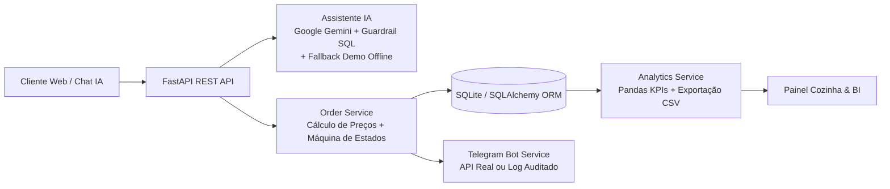

# Delicious Express AI — Sistema Inteligente de Delivery & Analytics

Evolução completa (v2.0) do meu projeto acadêmico de delivery (*Delicious Express*, originalmente criado em 2024 como landing page em Django com redirecionamento para Telegram), reescrito com arquitetura moderna de **APIs REST, Inteligência Artificial Generativa (Google Gemini), Automação de Notificações e Analytics com Pandas**.

---

## Problema empresarial resolvido

Pequenos e médios negócios de delivery enfrentam três gargalos operacionais:
1. **Atendimento manual repetitivo:** clientes enviam pedidos desestruturados por texto (WhatsApp/Telegram) e a equipe precisa interpretar, conferir preços e lançar manualmente.
2. **Erros de cálculo e controle:** falta de banco relacional e controle de status leva a pedidos perdidos ou divergências de valor.
3. **Ausência de indicadores:** sem estruturação dos dados, o negócio não consegue medir ticket médio, faturamento real nem os itens mais vendidos.

## Arquitetura da solução



## Evolução: v1 (2024) → v2 (2026)

| Aspecto | v1 (Faculdade — 2024) | v2 (Delicious Express AI — 2026) |
| --- | --- | --- |
| Backend | Landing page estática em Django | API REST em camadas com **FastAPI + Pydantic v2** |
| Dados | Sem persistência real de pedidos | **SQLAlchemy ORM** (`products`, `orders`, `order_items`, `notification_logs`) |
| Pedidos por texto | Link estático para bot externo | **Assistente IA (Google Gemini)** com saída estruturada JSON + modo demo offline |
| Notificações | Sem auditoria | Integração assíncrona com **Telegram Bot API** + tabela de auditoria |
| BI & Relatórios | Inexistente | Painel de KPIs (**Pandas**) + exportação **CSV** compatível com Excel |
| Engenharia & Segurança | `venv/` e `SECRET_KEY` no Git, sem testes | `.env` seguro, `.gitignore` limpo, `Dockerfile` e suíte de testes com **pytest** |

## Decisões técnicas e guardrails de IA

* **Zero alucinação de preços ou cardápio:** a LLM (Google Gemini com `response_schema` Pydantic) **nunca calcula valores** e só pode retornar `product_id` existentes no cardápio vivo do banco. O backend valida cada ID e recalcula todos os subtotais de forma determinística.
* **Resiliência (modo demo offline):** se `GEMINI_API_KEY` não estiver configurada (ou houver falha de rede/cota), o sistema ativa automaticamente um parser determinístico em português para que qualquer pessoa teste a aplicação localmente sem barreiras.
* **Máquina de estados:** pedidos seguem transições válidas (`recebido → em_preparo → saiu_para_entrega → entregue` ou `cancelado`), bloqueando alterações incoerentes via HTTP 400.

## Tecnologias utilizadas

* **Backend:** Python, FastAPI, Uvicorn, Pydantic v2, SQLAlchemy, HTTPX
* **IA & Automação:** Google Gemini API (`google-genai`), saída estruturada JSON, Telegram Bot API
* **Dados & BI:** Pandas, SQLite (pronto para PostgreSQL), exportação CSV UTF-8-BOM
* **Qualidade:** Pytest, FastAPI TestClient, Docker

## Como executar localmente

```bash
# 1. Criar e ativar ambiente virtual
python -m venv .venv
# Windows (PowerShell):
.\.venv\Scripts\Activate.ps1
# Linux / macOS:
# source .venv/bin/activate

# 2. Instalar dependências
pip install -r requirements.txt

# 3. (Opcional) Configurar variáveis de ambiente
cp .env.example .env
# Adicione GEMINI_API_KEY e/ou TELEGRAM_BOT_TOKEN se desejar o modo live

# 4. Iniciar servidor
uvicorn app.main:app --reload
```

Acesse no navegador:
* **Aplicação Web (Cardápio, Chat IA e Painel BI):** `http://127.0.0.1:8000`
* **Documentação interativa (Swagger / OpenAPI):** `http://127.0.0.1:8000/docs`

## Testes automatizados

```bash
pytest -v
```

Os testes usam banco SQLite em memória isolado e validam:
* Seed do cardápio e health check;
* Consolidação de itens duplicados, cálculo de preço no servidor e auditoria de notificação Telegram;
* Regras da máquina de estados dos pedidos;
* Extração em linguagem natural pelo Assistente IA, detecção de campos obrigatórios ausentes e criação automática de pedidos;
* Cálculo de KPIs (excluindo pedidos cancelados) e exportação CSV via Pandas.

## Próximos passos / melhorias futuras

* Migração para PostgreSQL + Alembic para versionamento de schema.
* Autenticação JWT para separar permissões de cliente e equipe da cozinha.
* Deploy gratuito em Render / Railway ou Hugging Face Spaces.

---

Desenvolvido por **Jonas Santos** — [GitHub](https://github.com/Jonaskest) • [LinkedIn](https://www.linkedin.com/in/jonas-santoss/)
